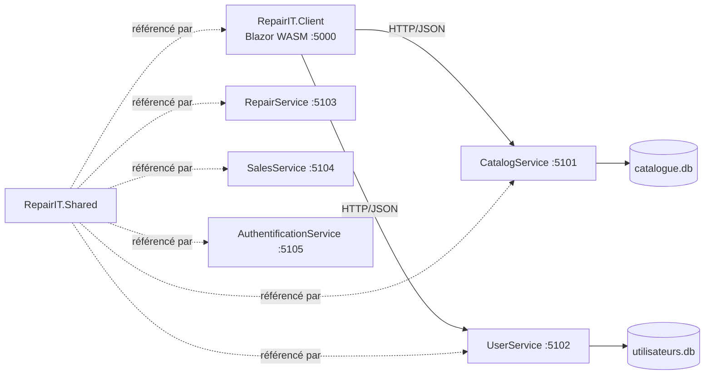
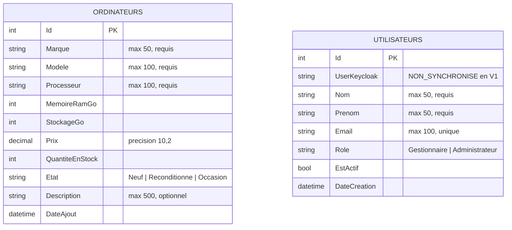

# RepairIT

Application de gestion d'un prestataire de **ventes et réparations d'ordinateurs**, développée en
**microservices ASP.NET Core** avec un front **Blazor WebAssembly**.
Projet du module *Environnement .NET et C# (ALTN71)*, EFREI 2026-2027.

> **Version actuelle : V1, catalogue informatique.**
> Squelette de la solution, CRUD des ordinateurs, gestion des utilisateurs, EF Core + SQLite, tests unitaires.

---

## Sommaire

1. [Démarrage rapide](#démarrage-rapide)
2. [Architecture](#architecture)
3. [Modèles de données](#modèles-de-données)
4. [API REST](#api-rest)
5. [Front Blazor](#front-blazor)
6. [Tests et couverture](#tests-et-couverture)
7. [Choix techniques](#choix-techniques)
8. [Feuille de route](#feuille-de-route)

---

## Démarrage rapide

**Prérequis :** SDK .NET 10 (`dotnet --list-sdks`).

| Script        | Rôle                                                                                   |
|---------------|----------------------------------------------------------------------------------------|
| `lancer.bat`  | Compile la solution, démarre les 5 APIs et le front (une fenêtre par projet), ouvre le navigateur |
| `arreter.bat` | Arrête tous les projets                                                                 |
| `tests.bat`   | Lance tous les tests avec couverture et génère un rapport HTML                         |

Une fois lancé :

| Application                | URL                                         |
|----------------------------|---------------------------------------------|
| Front (gestionnaire)       | http://localhost:5000                       |
| Front (administration)     | http://localhost:5000/admin                 |
| API Catalogue              | http://localhost:5101/api/ordinateurs       |
| API Utilisateurs           | http://localhost:5102/api/utilisateurs      |
| Documentation OpenAPI      | http://localhost:5101/openapi/v1.json (idem sur chaque API) |

Les bases SQLite (`catalogue.db`, `utilisateurs.db`) sont **créées et remplies automatiquement** au premier
démarrage. Pour repartir de zéro, il suffit de supprimer ces fichiers.

---

## Architecture

```
RepairIT/
├── RepairIT.sln
├── lancer.bat · arreter.bat · tests.bat
├── src/
│   ├── RepairIT.Client                   Front Blazor WebAssembly           :5000
│   ├── RepairIT.CatalogService           API catalogue d'ordinateurs        :5101  ✅ V1
│   ├── RepairIT.UserService              API gestion des utilisateurs       :5102  ✅ V1
│   ├── RepairIT.RepairService            API réparations                    :5103  (squelette, V2)
│   ├── RepairIT.SalesService             API ventes                         :5104  (squelette, V3)
│   ├── RepairIT.AuthentificationService  API authentification / Keycloak    :5105  (squelette, V5)
│   └── RepairIT.Shared                   DTO, énumérations, export CSV, options communes
└── tests/
    ├── RepairIT.CatalogService.Tests
    ├── RepairIT.UserService.Tests
    └── RepairIT.Shared.Tests
```



### Découpage d'un microservice

Chaque microservice implémenté suit la même organisation en couches :

```
Controllers/     → expose l'API REST, traduit les résultats en codes HTTP (200, 201, 204, 404, 409)
Services/        → règles métier, logging, conversion entité ↔ DTO (Mapper)
Repositories/    → accès aux données via EF Core, derrière une interface
Data/            → DbContext (configuration du modèle) + DbInitializer (création et données de démo)
Models/          → entités persistées
Configuration/   → classes d'options liées à appsettings.json
```

Le contrôleur ne connaît que l'interface du service, et le service que l'interface du repository.
Toutes les dépendances sont injectées : chaque couche peut donc être testée isolément avec Moq.

---

## Modèles de données

Chaque microservice possède **sa propre base** (principe *database per service*).



- **Aucun mot de passe** n'est stocké : l'authentification sera entièrement déléguée à Keycloak (V5).
  En V1, le champ `UserKeycloak` reçoit la valeur par défaut `NON_SYNCHRONISE`, comme demandé.
- Les énumérations (`Etat`, `Role`) sont stockées **en texte** pour rester lisibles en base.
- L'email est normalisé (minuscules, sans espaces) et protégé par un **index unique**.

### Données de démonstration

| Base             | Contenu initial                                                         |
|------------------|-------------------------------------------------------------------------|
| `catalogue.db`   | 6 ordinateurs (Dell, Apple, Lenovo, HP, Asus, Acer), dont 3 en stock faible |
| `utilisateurs.db`| 1 administrateur + 4 gestionnaires (correspond aux comptes Keycloak prévus en V5) |

L'initialisation se règle dans `appsettings.json` :

```json
"BaseDeDonnees": {
  "CreerAuDemarrage": true,
  "InjecterDonneesDeDemo": true
}
```

---

## API REST

### CatalogService : `/api/ordinateurs`

| Verbe    | Route                          | Description                                   | Réponses       |
|----------|--------------------------------|-----------------------------------------------|----------------|
| `GET`    | `/api/ordinateurs?recherche=x` | Liste (recherche marque/modèle/processeur)    | 200            |
| `GET`    | `/api/ordinateurs/{id}`        | Détail                                        | 200, 404       |
| `POST`   | `/api/ordinateurs`             | Ajout                                         | 201, 400       |
| `PUT`    | `/api/ordinateurs/{id}`        | Modification                                  | 200, 400, 404  |
| `DELETE` | `/api/ordinateurs/{id}`        | Suppression                                   | 204, 404       |
| `GET`    | `/api/ordinateurs/stock`       | État du stock (totaux, valeur, stock faible)  | 200            |
| `GET`    | `/api/ordinateurs/export`      | Export CSV du catalogue                       | 200 (text/csv) |

### UserService : `/api/utilisateurs`

| Verbe  | Route                              | Description                         | Réponses      |
|--------|------------------------------------|-------------------------------------|---------------|
| `GET`  | `/api/utilisateurs`                | Liste                               | 200           |
| `GET`  | `/api/utilisateurs/{id}`           | Détail                              | 200, 404      |
| `POST` | `/api/utilisateurs`                | Création                            | 201, 400, 409 (email déjà utilisé) |
| `PUT`  | `/api/utilisateurs/{id}/role`      | Attribution d'un rôle               | 200, 404      |
| `PUT`  | `/api/utilisateurs/{id}/activer`   | Activation du compte                | 200, 404      |
| `PUT`  | `/api/utilisateurs/{id}/desactiver`| Désactivation du compte             | 200, 404      |
| `GET`  | `/api/utilisateurs/export`         | Export CSV des utilisateurs         | 200 (text/csv) |

### Services squelettes

`RepairService`, `SalesService` et `AuthentificationService` exposent pour l'instant `GET /api/statut`,
ce qui permet de vérifier qu'ils démarrent correctement.

La validation des saisies repose sur les **DataAnnotations** des DTO partagés : la même règle
s'applique côté API (réponse 400 automatique grâce à `[ApiController]`) et côté formulaire Blazor.

---

## Front Blazor

Application Blazor WebAssembly sur le **port 5000**, avec un design personnalisé (pas de Bootstrap ni
du thème Blazor par défaut) : barre latérale, cartes d'indicateurs, tableaux, fenêtres modales et notifications.

| Page                       | Contenu                                                                    |
|----------------------------|----------------------------------------------------------------------------|
| **Accueil** `/`            | Indicateurs (références, unités, valeur du stock, utilisateurs actifs) et alertes de stock faible |
| **Ordinateurs** `/ordinateurs` | Catalogue avec recherche instantanée, ajout, modification, suppression avec confirmation, export CSV |
| **Administration** `/admin`| Utilisateurs : création, changement de rôle, activation/désactivation, export CSV |
| Réparations, Ventes, Tableau de bord, Connexion | Pages d'attente indiquant la version prévue (V2 à V5) |

Points techniques :

- **HttpClientFactory** et clients typés (`CatalogueApiClient`, `UtilisateursApiClient`) ; les URLs des
  APIs viennent de `wwwroot/appsettings.json`.
- **Événements C#** : `NotificationService` expose un `event Action<Notification>` auquel s'abonne le
  composant `Toasts`. Les composants communiquent via des `EventCallback` (`Modale`, `FormulaireOrdinateur`…).
- **Interop JavaScript** : `wwwroot/js/repairit.js` déclenche le téléchargement des exports CSV.
- Les réponses arrivées en retard lors d'une recherche rapide sont ignorées, pour ne jamais afficher un résultat périmé.

---

## Tests et couverture

Outils : **xUnit**, **Moq**, **EF Core InMemory**, **coverlet**, **ReportGenerator**.

```bash
tests.bat
# ou
dotnet test --collect:"XPlat Code Coverage"
```

| Projet de tests                 | Ce qui est testé                                                                    |
|---------------------------------|-------------------------------------------------------------------------------------|
| `RepairIT.CatalogService.Tests` | Service (repository mocké avec Moq), repository (EF InMemory), contrôleur (service mocké), initialisation de la base |
| `RepairIT.UserService.Tests`    | Mêmes couches, y compris le refus d'un email en double (409)                         |
| `RepairIT.Shared.Tests`         | Export CSV (échappement, formats, BOM UTF-8)                                       |

**Résultat V1 : 67 tests, 100 % de couverture des lignes** du code métier (objectif du sujet : 50 %).
Le code généré automatiquement (`obj/**`, source generators OpenAPI) et les `Program.cs` de démarrage sont
exclus de la mesure (`tests/coverage.runsettings`). Comme le demande le sujet, le front n'est pas testé.

L'heure courante est injectée via `TimeProvider`, ce qui rend les dates déterministes dans les tests.

---

## Choix techniques

| Choix | Justification |
|-------|---------------|
| **.NET 10** | Dernière version LTS |
| **Une base par microservice** | Les services restent indépendants ; prépare le passage à PostgreSQL (V2) et à Docker (V5) |
| **Pattern Repository + Service** | Sépare l'accès aux données des règles métier, et permet de tester chaque couche avec Moq |
| **DTO dans `RepairIT.Shared`** | Un seul contrat partagé entre APIs et front, sans exposer les entités EF |
| **Options typées** (`IOptions<T>`) | `CatalogueOptions` (seuil de stock faible), `BaseDeDonneesOptions` (initialisation) |
| **`ILogger<T>` partout** | Journalisation structurée des créations, modifications, suppressions et erreurs métier |
| **`EnsureCreated` + DbInitializer** | Suffisant pour la V1 avec SQLite. Les migrations EF Core seront introduites avec PostgreSQL en V2 |
| **Enums sérialisées en texte** | JSON lisible (`"etat": "Neuf"`) grâce à `JsonStringEnumConverter` sur les enums partagées |
| **CORS configurable** | Seule l'origine du front (`http://localhost:5000`) est autorisée, via `appsettings.json` |
| **Export CSV `;` + BOM UTF-8** | S'ouvre directement dans Excel en français, accents compris |

---

## Feuille de route

| Version | Contenu | Échéance | Statut |
|---------|---------|----------|--------|
| **V1** | Catalogue, utilisateurs, EF Core SQLite, tests | 20/11/2026 | ✅ |
| V2 | Clients, réparations, PostgreSQL (port 5432) | 06/12/2026 | ⏳ |
| V3 | Ventes, chiffre d'affaires, top produits (LINQ, async) | 20/12/2026 | ⏳ |
| V4 | Gateway, intégration complète du front, tableau de bord | 10/01/2027 | ⏳ |
| V5 | Keycloak (OAuth2/OIDC, JWT, rôles), Docker Compose | 24/01/2027 | ⏳ |

### Workflow Git

- `production` : dernière version validée par l'enseignant.
- `main` : développement en cours.
- Chaque rendu fait l'objet d'une **Merge Request `main` → `production`**.
